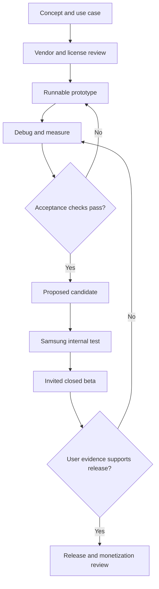

# Project Premonition: concept to paid product

Status: local Python workflow-card prototype, not an installed Android app.
Base and rollback: f0cb6ee54066b490c0e80efc2c96200fec76ee2d.
Task: premonitionPrototype; scope: localCardDraft. Source changes are additive;
revert this proposal to remove them. No existing APK or release identity changes.

## First vertical slice

The two starting pieces are the existing Samsung/Godot Android runtime and the
repository's Python/SQLite tools. This prototype implements the Python side:
four channels enter a bounded packet and become reviewable workflow cards.
It reuses tools/typedSqlStub.py and host/api/typedLanesV1.sql unchanged.
There is no phone-to-Python connection yet. The input sourceRef identifies the
packet's target source; it is not attestation of the executing tool's version.

| Channel | Hear | Resolve | Act in this prototype | Verify |
| --- | --- | --- | --- | --- |
| Chat | Preserve original text | Explicit block selection | Draft card | Exact text and input hash |
| Voice transcript | Preserve supplied transcript | Foreground label or context | Draft only for foreground label | Background stays context |
| Asset note | Preserve reference note | Context only | Record note | No implied asset rights |
| Device observation | Preserve observation | Context only | Record note | No invented phone measurements |

The caller supplies source labels; they are not speaker authentication. No label
grants execution. Four block templates are storyboardDraft, assetReview,
gameSceneDraft and deviceCheck. Templates describe intended inputs and output;
they do not generate a storyboard, modify an asset or run a device test.
An editable JSON packet is the prototype's interface. The optional `--save`
command creates a private mode-0600 draft file and refuses overwrite; `--load`
recompiles its bounded JSON packet and checks the SHA-256 digest. This detects
accidental edits, not malicious forgery or identity. The user controls the file
path; keep private transcripts outside Git and shared directories. These are
local source-only commands, not a Samsung editor or synced cloud storage. A visual block editor,
speech recognition, audio waveform analysis and raw microphone capture remain
unimplemented. The in-memory database is discarded after compilation; receipt
timestamps are synthetic fixture data, not real observations.

## Development flow



## Reproduce and debug

From repository root:

```bash
python3 tests/testNoCodePrototype.py
python3 tools/noCodePrototype.py --demo
python3 tools/noCodePrototype.py --input packet.json
python3 tools/noCodePrototype.py --input packet.json --save local-draft.json
python3 tools/noCodePrototype.py --load local-draft.json
```

The demo should produce two DRAFT_REVIEW cards and two CONTEXT_ONLY records.
Tests exercise determinism, preservation, ambiguous/background input, command-like
text, unknown blocks, malformed source refs, duplicate IDs, input limits and receipt
identity changes. Six local unittest methods passed during preparation. This proves
only the local card compiler, not a full Canon audit, semantic AI or Android runtime.

Next prototype increment: an editable Samsung-facing card preview that imports and
exports this packet, with an explicit preview step. Local CLI save/load is now
implemented as a candidate, pending exact-head CI and device proof. Choose local embedded Python
versus a separately authenticated optional host adapter only after measuring a real
need. Do not ship the Python MCP server or credentials inside the Android APK.

## Promotion evidence

| Stage | Required exit evidence | Current state |
| --- | --- | --- |
| Concept | Artist-first use case and bounded first interaction | Documented |
| Prototype | Runnable compiler and negative tests | Locally tested |
| Proposed | Exact-source review, CI and Samsung interface integration | Pending |
| Internal test | Signed Play AAB, actual phone install, touch, resume, saves | Pending |
| Closed beta | Approved branding, Console release, real opt-in link, feedback | Pending |
| Monetization | Stable product, retention/support evidence, rights and billing review | Not implemented |

The first beta goal is one complete creative interaction, not every development
tool bundled together. Pricing and billing remain undecided. Invitations are drafts
until there is a functioning release and a real tester link.

## Vendor notebook and source reuse

For each imported component record upstream URL, immutable commit/version,
license and notices, role, dependency cost, local modifications, validation and
update owner. Available source code alone does not grant redistribution rights.
No upstream code was copied in this prototype; existing first-party adapter code
was reused. Vendor manuals reviewed during the preceding research establish:

| Upstream | Useful role | Decision |
| --- | --- | --- |
| CPython Android docs | Embedded Python packaging | Evaluate only if runtime Python is necessary |
| Panda3D 1.11 Android manual | Python/C++ AAB route | Optional experiment, no engine switch |
| Godot Android manual | Current runtime export | Preserve first beta path |
| Unreal Python manual | Editor and content automation | Future adapter; not Python gameplay |

References checked 2026-11-01:
- https://docs.python.org/3/using/android.html
- https://docs.panda3d.org/1.11/python/distribution/building-for-android
- https://docs.godotengine.org/en/stable/tutorials/export/exporting_for_android.html
- https://dev.epicgames.com/documentation/en-us/unreal-engine/scripting-the-unreal-editor-using-python

Play branding, upload/app-signing distinction and tester setup remain in the
existing PR #425 manual/googlePlayReleaseRunbook.md proposal. This prototype
does not merge that proposal, repair signing PR #378, or unlock backend workers.


## Hardware reduction and compatibility policy — 2026-11-01

Proposed policy, not device certification. Observed main source: Android min SDK 24,
target SDK 36, arm64-v8a only; project.godot selects gl_compatibility on mobile
and has audio/driver/enable_input=false. Source settings do not establish an
oldest supported physical Samsung. The product floor is the oldest exact model,
OS build and driver combination that passes the shipped feature suite.

| Decision | First-beta policy | Evidence before expansion |
| --- | --- | --- |
| CPU ABI | ARM64; keep existing single ABI | Add ARMv7 only for identified users/devices and complete native-library tests |
| Graphics | Existing OpenGL ES Compatibility path | Vulkan as an optional measured renderer after scene/shader parity tests |
| DirectX 5 | No new backend | No current Samsung delivery requirement justifies it |
| PlayStation 2 | Historical architecture research only | Separate emulator/port project with actual use case and license review |
| Drivers | Use supported OS interfaces | Never remove Samsung firmware/kernel drivers for app slimming |
| Audio | Playback first; explicit capture later | Permissions, echo, timing, reconnect, privacy and device proof |
| Webcam | One supported source before multiple cameras | Device enumeration, formats, USB power/bandwidth, clocks and dropped frames |
| Linux studio | Evaluate PipeWire with PulseAudio compatibility | Separate host adapter; do not make Linux audio services Android prerequisites |

Graphics APIs and CPU ABI are separate axes: 64-bit does not require Vulkan.
Historical minimum engine versions must not be mixed with current export requirements.
Measure Android minimum OS, GPU feature availability, native library ABI, memory and
thermal behavior independently. Do not widen the shipping matrix merely because an
engine advertises broad platform support.

### Easiest-to-hardest prototype increments

1. Offline packet/card editor and local save/load.
2. One real Samsung scene using the existing renderer, with measured launch,
   frame-time, peak memory and bounded cache.
3. One internal camera and one microphone, separately, then together with
   permission denial and interruption tests. Existing microphone setting is off;
   no capture is currently proved by the card compiler.
4. One USB UVC webcam if the actual Samsung exposes a supported path.
5. Multiple cameras on a Linux studio host, with a phone-facing control interface.
6. Multi-camera synchronization, rotoscoping/motion capture and live effects.
7. Optional alternate renderer, embedded Python runtime or emulator integration,
   only when a preceding experiment exposes a concrete need.

The order is an engineering estimate, not a measured complexity benchmark.
For each increment record the number of setup steps, external dependencies,
privileged actions, latency, failure rate and recovery steps. Reuse the same
versioned event envelope, explicit units, monotonic timestamps, capability IDs,
bounded queues, cancellation and error receipts across adapters. These shared
interfaces reduce repeated work in the difficult stages.

### Byte-level inspection where it answers a question

- Binary schema: magic/version, fixed-width fields, signedness, endianness, length
  bounds and checksum/hash where appropriate. Never reinterpret an arbitrary blob
  without a known format or parser.
- Native Android: actual ABI, ELF alignment, ZIP alignment and runtime behavior on
  both relevant page-size environments. Alignment alone is not runtime proof.
- Camera: pixel format, frame dimensions, stride, frame rate, compression and
  timestamps. Raw payload estimate = width × height × bytes per pixel × frames/s;
  include transport overhead and measured sustained bandwidth.
- Audio: sample rate, channels, sample format, frames per buffer, clock drift and
  underruns. Do not equate a smaller buffer with better behavior without testing.
- Network: inspect our own test traffic and protocol boundaries only when the
  adapter actually uses networking. The offline core requires no packet capture.
- Escalate 1, 2, 4, 8 concurrent inputs only while measured budgets pass; stop or
  degrade quality at the first limit. Hexadecimal is a representation, not a
  performance accelerator.

Prune unused app assets, codecs, plugins, ABIs and build dependencies first, with
before/after artifact size, behavior tests and license notices preserved. Do not
remove platform drivers or rewrite a kernel to reduce APK size. Emulator tests
help reproduce API/ABI/parser failures but do not certify physical USB, Bluetooth,
camera synchronization or Samsung thermal behavior.

### Vendor evidence and update workflow

Pin upstream release/commit; read release notes, relevant issues and migration
guides; inspect the narrow diff; retain license/notices; reproduce a minimal test;
update one adapter; compare against the last passing build; record rollback.
Do not chase every upstream commit or treat open source as automatic license
compatibility. Architecture emulation does not make foreign drivers portable.

Official references consulted:
- Godot system/renderer requirements: https://docs.godotengine.org/en/stable/about/system_requirements.html
- Android native page sizes: https://developer.android.com/guide/practices/page-sizes
- Android USB camera architecture: https://source.android.com/docs/core/camera/external-usb-cameras
- PipeWire PulseAudio compatibility: https://docs.pipewire.org/devel/page_man_pipewire-pulse_1.html

Android USB camera support depends on the device's USB host, kernel and camera
provider configuration; a generic AOSP implementation is not proof for this phone.
PipeWire's PulseAudio-compatible service is a Linux studio integration option.
No drivers, microphone permissions, export presets or hardware were changed here.
