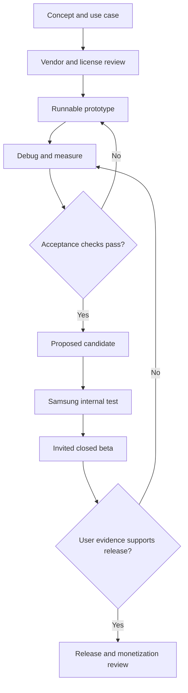

# Project Premonition: concept to paid product

Status: local Python workflow-card prototype, not an installed Android app.
Base and rollback: f0cb6ee54066b490c0e80efc2c96200fec76ee2d.
Task: premonitionPrototype; scope: localCardDraft. Source changes are additive;
revert this proposal to remove them. No existing APK or release identity changes.

## First vertical slice

The two starting pieces are the existing Samsung/Godot Android runtime and the
repository's Python/SQLite tools. This prototype implements the Python side:
four channels enter a bounded packet and become reviewable workflow cards.
It reuses tools/typedSqlStub.py and host/api/typedLanesV1.sql unchanged.
There is no phone-to-Python connection yet. The input sourceRef identifies the
packet's target source; it is not attestation of the executing tool's version.

| Channel | Hear | Resolve | Act in this prototype | Verify |
| --- | --- | --- | --- | --- |
| Chat | Preserve original text | Explicit block selection | Draft card | Exact text and input hash |
| Voice transcript | Preserve supplied transcript | Foreground label or context | Draft only for foreground label | Background stays context |
| Asset note | Preserve reference note | Context only | Record note | No implied asset rights |
| Device observation | Preserve observation | Context only | Record note | No invented phone measurements |

The caller supplies source labels; they are not speaker authentication. No label
grants execution. Four block templates are storyboardDraft, assetReview,
gameSceneDraft and deviceCheck. Templates describe intended inputs and output;
they do not generate a storyboard, modify an asset or run a device test.
An editable JSON packet is the prototype's interface. A visual block editor,
speech recognition, audio waveform analysis and raw microphone capture remain
unimplemented. The in-memory database is discarded after compilation; receipt
timestamps are synthetic fixture data, not real observations.

## Development flow



## Reproduce and debug

From repository root:

```bash
python3 tests/testNoCodePrototype.py
python3 tools/noCodePrototype.py --demo
python3 tools/noCodePrototype.py --input packet.json
```

The demo should produce two DRAFT_REVIEW cards and two CONTEXT_ONLY records.
Tests exercise determinism, preservation, ambiguous/background input, command-like
text, unknown blocks, malformed source refs, duplicate IDs, input limits and receipt
identity changes. Six local unittest methods passed during preparation. This proves
only the local card compiler, not a full Canon audit, semantic AI or Android runtime.

Next prototype increment: an editable Samsung-facing card preview that imports and
exports this packet, with an explicit preview step. Choose local embedded Python
versus a separately authenticated optional host adapter only after measuring a real
need. Do not ship the Python MCP server or credentials inside the Android APK.

## Promotion evidence

| Stage | Required exit evidence | Current state |
| --- | --- | --- |
| Concept | Artist-first use case and bounded first interaction | Documented |
| Prototype | Runnable compiler and negative tests | Locally tested |
| Proposed | Exact-source review, CI and Samsung interface integration | Pending |
| Internal test | Signed Play AAB, actual phone install, touch, resume, saves | Pending |
| Closed beta | Approved branding, Console release, real opt-in link, feedback | Pending |
| Monetization | Stable product, retention/support evidence, rights and billing review | Not implemented |

The first beta goal is one complete creative interaction, not every development
tool bundled together. Pricing and billing remain undecided. Invitations are drafts
until there is a functioning release and a real tester link.

## Vendor notebook and source reuse

For each imported component record upstream URL, immutable commit/version,
license and notices, role, dependency cost, local modifications, validation and
update owner. Available source code alone does not grant redistribution rights.
No upstream code was copied in this prototype; existing first-party adapter code
was reused. Vendor manuals reviewed during the preceding research establish:

| Upstream | Useful role | Decision |
| --- | --- | --- |
| CPython Android docs | Embedded Python packaging | Evaluate only if runtime Python is necessary |
| Panda3D 1.11 Android manual | Python/C++ AAB route | Optional experiment, no engine switch |
| Godot Android manual | Current runtime export | Preserve first beta path |
| Unreal Python manual | Editor and content automation | Future adapter; not Python gameplay |

References checked 2026-11-01:
- https://docs.python.org/3/using/android.html
- https://docs.panda3d.org/1.11/python/distribution/building-for-android
- https://docs.godotengine.org/en/stable/tutorials/export/exporting_for_android.html
- https://dev.epicgames.com/documentation/en-us/unreal-engine/scripting-the-unreal-editor-using-python

Play branding, upload/app-signing distinction and tester setup remain in the
existing PR #425 manual/googlePlayReleaseRunbook.md proposal. This prototype
does not merge that proposal, repair signing PR #378, or unlock backend workers.
